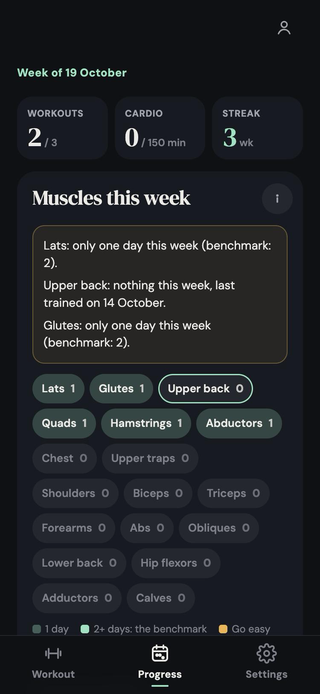

# Routine

**Live app: [marl75.github.io/fitness-coach](https://marl75.github.io/fitness-coach/)** · available in English and French

**Try it without an account: [demo mode](https://marl75.github.io/fitness-coach/?demo&lang=en)** (any email and password work; fake data, kept in your browser)

(Formerly FitCoach; the address is unchanged.)

A small progressive web app to log workouts and keep track of your consistency.

## Features

- **Routines**: save any workout as a routine and start it in one tap from the start screen ("What are we doing today?")
- **Workout**: add exercises as you go; everything is pre-filled from last time, strength and cardio alike (cardio becomes the current card with its own steppers)
- **Sets table**: one row per set (weight, reps, check); the current set has its own − / + for reps, so a shorter last set takes two taps; tapping a number opens the weight stack and exact weight field (steps of 0.25 to 2.5 kg)
- **Details per exercise**: speed and incline for incline walking, resistance and intensity for the bike, laps on a saved track with the weight carried in each hand… plus a comment; any extra detail can be added and is remembered
- **Strength setup**: machine or not, dumbbells, position, bench (flat, incline, decline and angle), movement (your own options are remembered) and the muscle you want to work, next to the muscles the exercise really works
- **Everything from last time is pre-filled**: weights, reps, setup, speed, incline, track…
- **A picture for every exercise**: a line figure doing the movement, with the muscles it works highlighted in green (custom exercises get a generic figure with the muscles you chose)
- **Goals per muscle**: mark muscles to develop or to go easy on (e.g. upper traps); muscles to go easy on show in orange with a warning, and a “My goals” filter lists the best-matching exercises first
- **Good form tips** for each exercise (do / avoid, plus a tip for your muscle goals), only from reliable sources cited on the card (ExRx.net, Concept2, NSCA, studies), and personal notes kept across sessions
- **Muscles this week** (Progress tab): days each muscle was worked (strength, cardio and core alike) against the benchmark of 2 days a week (ACSM 2026), plus cardio minutes against 150 a week (WHO), with alerts
- **Rep targets and progression**: set a rep range per exercise (e.g. 8 to 12); when you reach the top on every set, the app suggests adding 2 to 10% (ACSM 2009) in one line, applied with one tap
- **My custom exercises**: link them to an exercise from the list (history, favourites and notes move over) or set their muscles
- **Custom exercises and variants** with the details you choose; in French, catalogue exercises also show their English name
- **Exercise picker** with categories, favourites and duplicate detection; unused exercises can be hidden
- **Log another day** from a calendar showing the days you trained
- **Progress**: calendar of days with and without exercise, workouts per week against a goal, progress per exercise
- **Dark mode**

## Stack

- Plain HTML, CSS and JavaScript, no build step
- [Firebase](https://firebase.google.com/) Authentication (email and password) and Firestore; configuration in `js/config.js`, security rules in `firestore.rules`
- Language follows the browser; `?lang=en` or `?lang=fr` in the address forces it
- Without a configuration, or with `?demo` in the address, the app runs in demo mode with fake data kept in the browser
